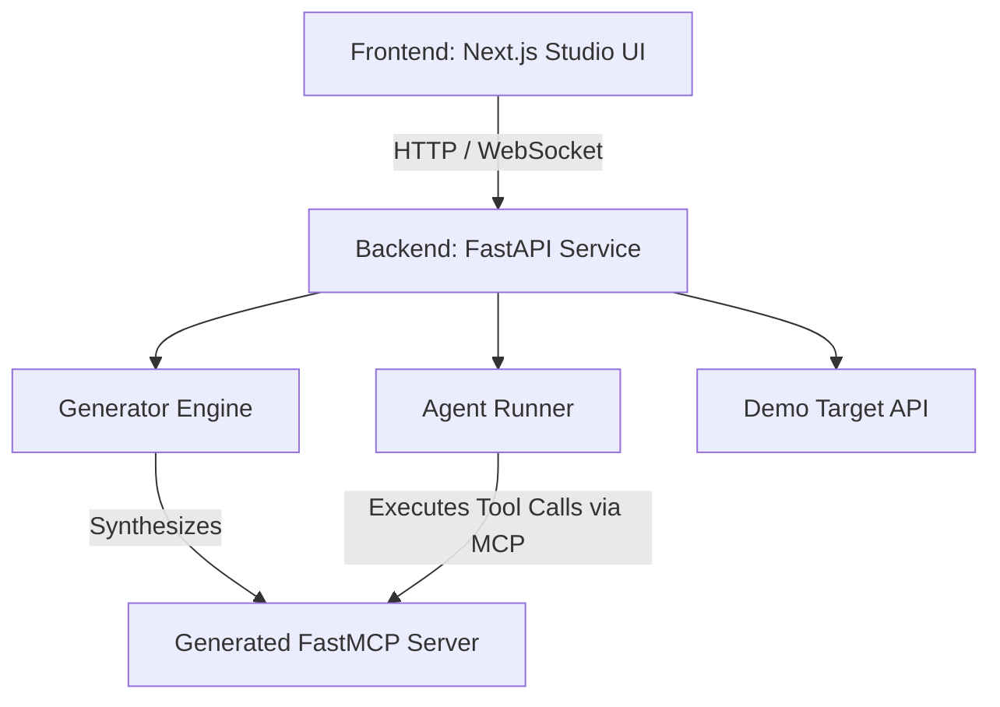

# Anything-to-MCP Studio (CampusCare Edition)

An autonomous platform to convert arbitrary REST APIs, schemas, and specs into Model Context Protocol (MCP) servers and interactive agent playgrounds.

## Overview
Anything-to-MCP Studio (CampusCare Edition) is designed to streamline the bridging of legacy services and campus management systems into AI-ready MCP endpoints. With a single schema or OpenAPI specification, the studio inspects, generates, tests, and deploys high-performance MCP servers compatible with Gemini and other LLM agent ecosystems.

## Architecture
- **Frontend**: Next.js (App Router, TypeScript, Tailwind CSS, Monaco Editor, Lucide Icons, Framer Motion)
- **Backend**: FastAPI + FastMCP / MCP SDK, Python 3.11+
- **Agent Integration**: Google GenAI SDK (`google-genai`), Pydantic v2 validation
- **Deployment**: Render Blueprint (`render.yaml`)



## Setup Instructions

### Prerequisites
- Node.js (v18+) & npm
- Python (v3.10+)
- Git

### Backend Setup
1. Create and activate a Python virtual environment:
   ```bash
   # Windows
   python -m venv backend/.venv
   backend\.venv\Scripts\activate

   # macOS / Linux
   python3 -m venv backend/.venv
   source backend/.venv/bin/activate
   ```
2. Install Python dependencies:
   ```bash
   pip install -r backend/requirements.txt
   ```
3. Configure environment variables:
   ```bash
   cp backend/.env.example backend/.env
   # Populate GEMINI_API_KEY with your valid key
   ```
4. Start the backend development server:
   ```bash
   uvicorn backend.main:app --reload --port 8000
   ```

### Frontend Setup
1. Install npm dependencies:
   ```bash
   cd frontend
   npm install
   ```
2. Configure frontend environment variables:
   ```bash
   # In frontend/.env.local
   NEXT_PUBLIC_BACKEND_URL=http://localhost:8000
   ```
3. Run the development server:
   ```bash
   npm run dev
   ```
4. Open [http://localhost:3000](http://localhost:3000) in your browser.

## Known Limitations
- Generated MCP servers currently require FastMCP runtime dependencies.
- Dynamic tool generation assumes standard JSON/OpenAPI schema inputs.
- Agent sandbox runner requires a valid Gemini API key with network access.
